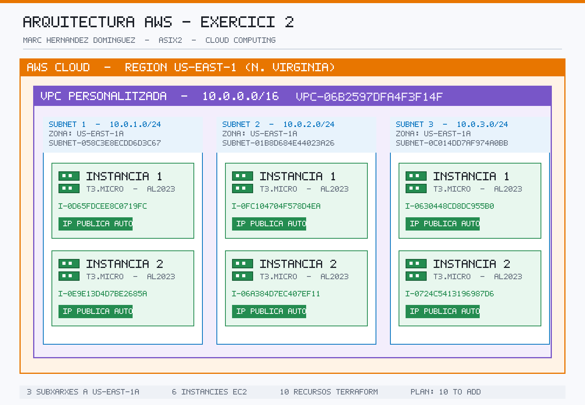

# practiquescloud

Pràctiques del mòdul de **Cloud Computing (ASIX2)** — Marc Hernandez Dominguez.

## Exercicis

### Exercici 2 — VPC personalitzada i 6 instàncies EC2

Desplegament amb **Terraform** d'una VPC `10.0.0.0/16` a `us-east-1`, amb 3 subxarxes
a `us-east-1a` (`10.0.1.0/24`, `10.0.2.0/24`, `10.0.3.0/24`) i **6 instàncies EC2
`t3.micro`** amb Amazon Linux 2023 (2 per subxarxa).

- 📄 [Documentació de l'Exercici 2](pt1-4-ex2/README.md)
- 💻 [Codi Terraform](pt1-4-ex2/main.tf)
- 🖼️ [Imatges del desplegament](pt1-4-ex2/assets/)

### Exercici 1 — 2 instàncies EC2 amb Terraform

Desplegament amb **Terraform** de 2 instàncies `t3.micro` amb Amazon Linux 2023 a la VPC
per defecte de `us-east-1`.

- 📄 [Documentació de l'Exercici 1](pt1-4-ex1/README.md)
- 💻 [Codi Terraform](pt1-4-ex1/main.tf)

---

*Autor: Marc Hernandez Dominguez — ASIX2, Cloud Computing.*
