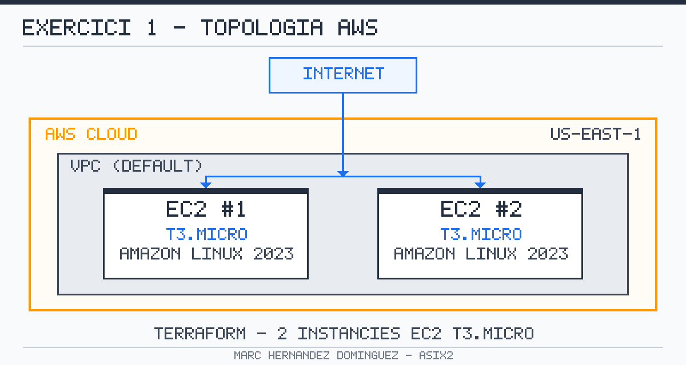

# Exercici 1 — Desplegament de 2 instàncies EC2 amb Terraform

| | |
|---|---|
| **Alumne** | Marc Hernandez Dominguez |
| **Mòdul** | Cloud Computing (ASIX2) |
| **Repositori** | [practiquescloud](https://github.com/MarcOrnstein/practiquescloud) |
| **Tecnologia** | Terraform + AWS |
| **Data** | Octubre de 2026 |

---

## 1. Objectiu

L'objectiu d'aquest exercici és desplegar de manera automàtica, amb **Terraform**, la
infraestructura bàsica següent a **AWS** (regió `us-east-1`):

- **2 instàncies EC2** de tipus `t3.micro`.
- Sistema operatiu **Amazon Linux 2023**, seleccionat dinàmicament amb un bloc
  `data "aws_ami"` que cerca sempre l'AMI més recent.
- Sortides (`output`) amb els **IDs** i les **IPs públiques** de les instàncies.

Amb aquest exercici es practiquen els conceptes d'**Infraestructura com a Codi (IaC)**:
definir recursos en fitxers de configuració, planificar els canvis i aplicar-los de
forma reproduïble.

---

## 2. Topologia



| Recurs | Descripció |
|---|---|
| Regió | `us-east-1` (N. Virginia) |
| Instàncies | `2` |
| Tipus d'instància | `t3.micro` |
| AMI | Amazon Linux 2023 (`al2023-ami-2023.*-x86_64`, la més recent) |
| Xarxa | VPC per defecte (subxarxa pública) |
| Accés | IP pública assignada automàticament |

---

## 3. Estructura del projecte

```text
pt1-4-ex1/
├── main.tf              # Configuració de Terraform (provider, AMI, EC2 i outputs)
├── README.md            # Aquest document
└── assets/
    └── topologia.png    # Diagrama de la infraestructura
```

---

## 4. Requisits previs

1. **Terraform** instal·lat (versió `>= 1.5`):

   ```bash
   terraform version
   ```

2. **AWS CLI** configurada amb unes credencials vàlides i permisos per crear
   instàncies EC2:

   ```bash
   aws configure
   aws sts get-caller-identity
   ```

   Les credencials es poden proporcionar de diverses maneres (perfil de l'AWS CLI,
   variables d'entorn `AWS_ACCESS_KEY_ID` / `AWS_SECRET_ACCESS_KEY` o rol d'IAM).
   **No** s'han de pujar mai al repositori.

3. Connexió a Internet perquè Terraform descarregui el provider `hashicorp/aws`.

---

## 5. Posada en marxa pas a pas

Totes les comandes s'executen des de la carpeta `pt1-4-ex1/`:

```bash
cd pt1-4-ex1
```

### Pas 1 — Inicialitzar el projecte

Descarrega el provider d'AWS i crea el directori `.terraform/`:

```bash
terraform init
```

### Pas 2 — Formatar i validar la configuració (opcional però recomanat)

```bash
terraform fmt
terraform validate
```

### Pas 3 — Planificar els canvis

Mostra què crearà Terraform **sense** aplicar cap canvi a AWS:

```bash
terraform plan
```

Revisa que el pla inclogui **2 instàncies** `t3.micro` i que la sortida sigui
`Plan: 2 to add, 0 to change, 0 to destroy`.

### Pas 4 — Aplicar la configuració

Crea la infraestructura real a AWS. Cal confirmar amb `yes`:

```bash
terraform apply
```

Alternativament, sense confirmació interactiva:

```bash
terraform apply -auto-approve
```

En acabar, Terraform mostra els outputs, per exemple:

```text
Apply complete! Resources: 2 added, 0 changed, 0 destroyed.

Outputs:

instance_ids = [
  "i-0123456789abcdef0",
  "i-0fedcba9876543210",
]
public_ips = [
  "54.123.45.67",
  "3.210.98.76",
]
```

Es poden tornar a consultar en qualsevol moment amb:

```bash
terraform output
terraform output public_ips
```

### Pas 5 — Comprovar el desplegament (opcional)

```bash
aws ec2 describe-instances \
  --region us-east-1 \
  --filters "Name=tag:Module,Values=pt1-4-ex1" \
  --query "Reservations[].Instances[].{ID:InstanceId,IP:PublicIpAddress,Type:InstanceType,State:State.Name}" \
  --output table
```

---

## 6. Destruir la infraestructura

Quan s'acabi l'exercici, **cal eliminar els recursos** per evitar costos:

```bash
terraform destroy
```

O bé, sense confirmació interactiva:

```bash
terraform destroy -auto-approve
```

Comprova que la sortida sigui `Destroy complete! Resources: 2 destroyed.`

---

## 7. Neteja de fitxers locals

Terraform genera fitxers i directoris que **no** s'han de versionar
(`.terraform/`, `terraform.tfstate*`, `.terraform.lock.hcl` és opcional).
Es recomana afegir un `.gitignore` al repositori amb:

```gitignore
.terraform/
*.tfstate
*.tfstate.*
crash.log
*.tfvars
```

> ⚠️ El fitxer `terraform.tfstate` pot contenir informació sensible. En entorns
> reals es recomana desar l'estat en un backend remot (per exemple, S3).

---

## 8. Costos

`t3.micro` és elegible per al **nivell gratuït** d'AWS (750 hores/mes durant els
primers 12 mesos), però **dues instàncies engegades 24/7 consumeixen 1.500
hores/mes**, per tant poden generar costos. Recorda executar `terraform destroy`
en acabar.

---

## 9. Resum de recursos creats

| Nom | Tipus | Descripció |
|---|---|---|
| `aws_instance.web[0]` | `t3.micro` | `practiquescloud-ex1-instance-1` |
| `aws_instance.web[1]` | `t3.micro` | `practiquescloud-ex1-instance-2` |

**Outputs:** `instance_ids`, `public_ips`

---

*Autor: Marc Hernandez Dominguez — ASIX2, Cloud Computing.*
