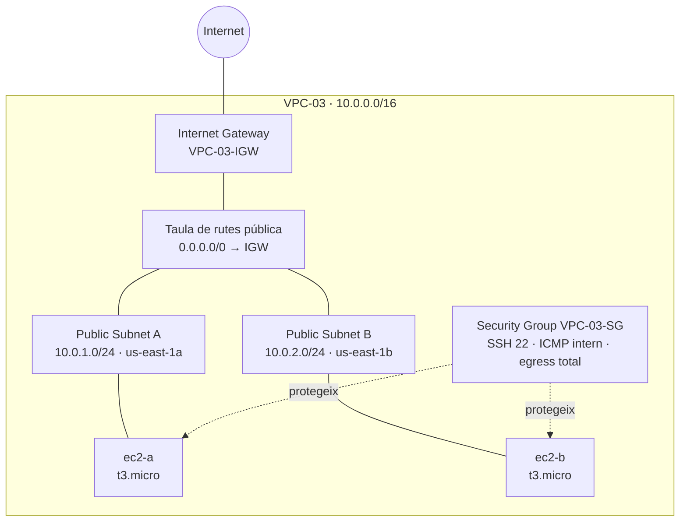

# Pràctica 2.2 (Pt2.2) — VPC, subxarxes públiques i 2 instàncies EC2 amb Terraform

| | |
|---|---|
| **Alumne** | Marc Hernandez Dominguez |
| **Mòdul** | Cloud Computing (ASIX2) |
| **Repositori** | [practiquescloud](https://github.com/MarcOrnstein/practiquescloud) |
| **Tecnologia** | Terraform + AWS |
| **Regió** | `us-east-1` (N. Virginia) |
| **Carpeta** | `pt2-2/` |

---

## 1. Objectiu

Desplegar amb **Terraform** una infraestructura bàsica però completa a AWS, aplicant els
conceptes d'**Infraestructura com a Codi (IaC)**:

- Una **VPC** anomenada `VPC-03` amb CIDR `10.0.0.0/16`.
- Dues **subxarxes públiques** en zones de disponibilitat diferents:
  - `Public Subnet A` → `10.0.1.0/24` a `us-east-1a`.
  - `Public Subnet B` → `10.0.2.0/24` a `us-east-1b`.
- Un **Internet Gateway** i una **taula de rutes pública** (`0.0.0.0/0`) associada a les
  dues subxarxes.
- Un **Security Group** amb:
  - SSH (port 22) des de qualsevol lloc.
  - ICMP (*ping*) només des de dins de la VPC (`10.0.0.0/16`).
  - Tot el tràfic de sortida permès.
- Dues **instàncies EC2** `t3.micro` amb Amazon Linux 2023:
  - `ec2-a` a `Public Subnet A`.
  - `ec2-b` a `Public Subnet B`.
- El par de claus **`vockey`** i el Security Group creat.

---

## 2. Arquitectura



### Resum de xarxes

| Recurs | Nom | CIDR | Zona |
|---|---|---|---|
| VPC | `VPC-03` | `10.0.0.0/16` | `us-east-1` |
| Subxarxa pública | `Public Subnet A` | `10.0.1.0/24` | `us-east-1a` |
| Subxarxa pública | `Public Subnet B` | `10.0.2.0/24` | `us-east-1b` |

Les dues subxarxes tenen `map_public_ip_on_launch = true`, de manera que qualsevol
instància llançada en elles rep automàticament una IP pública.

---

## 3. Estructura de fitxers

```text
pt2-2/
├── provider.tf      # Versió de Terraform, provider AWS i regió us-east-1
├── vpc.tf           # VPC-03, subxarxes, Internet Gateway i taula de rutes
├── security.tf      # Security Group i regles d'entrada/sortida
├── ec2.tf           # AMI d'Amazon Linux 2023 i instàncies ec2-a / ec2-b
├── outputs.tf       # IDs, IPs públiques/privades i comandes SSH
├── README.md        # Aquesta documentació
└── .gitignore       # Exclou state, .terraform/ i claus .pem
```

---

## 4. Requisits previs

1. **Terraform** instal·lat (versió `>= 1.5`):

   ```bash
   terraform version
   ```

2. **AWS CLI** configurada amb credencials vàlides:

   ```bash
   aws configure
   aws sts get-caller-identity
   ```

3. **Par de claus `vockey`** creat a la regió `us-east-1`.

   > Als laboratoris d'**AWS Academy** aquesta clau ja existeix. Cal descarregar el fitxer
   > `vockey.pem` des del laboratori i donar-li permisos restrictius:
   >
   > ```bash
   > chmod 400 vockey.pem
   > ```

4. Permisos per crear VPC, subxarxes, Security Groups i instàncies EC2.

> ⚠️ Les credencials d'AWS i el fitxer `vockey.pem` **no** s'han de pujar mai al repositori.

---

## 5. Desplegament

Totes les comandes s'executen des de la carpeta `pt2-2/`:

```bash
cd pt2-2
```

### Pas 1 — Inicialitzar el projecte

Descarrega el provider d'AWS i crea el directori `.terraform/`:

```bash
terraform init
```

### Pas 2 — Formatar i validar (recomanat)

```bash
terraform fmt
terraform validate
```

### Pas 3 — Revisar el pla

Mostra els recursos que es crearan sense aplicar cap canvi real:

```bash
terraform plan
```

El pla ha de contenir, entre d'altres:

```text
Plan: 10 to add, 0 to change, 0 to destroy.
```

> El nombre exacte pot variar segons la versió del provider, però han d'aparèixer
> la VPC, 2 subxarxes, l'IGW, la taula de rutes, 2 associacions, el Security Group
> i les 2 instàncies EC2.

### Pas 4 — Aplicar la configuració

```bash
terraform apply
```

Cal confirmar amb `yes`. Alternativament:

```bash
terraform apply -auto-approve
```

En acabar, Terraform mostrarà les sortides, per exemple:

```text
Apply complete! Resources: 10 added, 0 changed, 0 destroyed.

Outputs:

instance_ids = {
  "ec2_a" = "i-0a1b2c3d4e5f6g7h8"
  "ec2_b" = "i-0b2c3d4e5f6g7h8i9"
}
public_ips = {
  "ec2_a" = "54.123.45.67"
  "ec2_b" = "54.123.45.89"
}
ssh_commands = {
  "ec2_a" = "ssh -i vockey.pem ec2-user@54.123.45.67"
  "ec2_b" = "ssh -i vockey.pem ec2-user@54.123.45.89"
}
vpc_id = "vpc-0abc1234def567890"
```

### Pas 5 — Consultar les sortides

```bash
terraform output
terraform output public_ips
terraform output ssh_commands
```

---

## 6. Verificació del desplegament

### 6.1. Connectar-se per SSH

```bash
ssh -i vockey.pem ec2-user@<IP_PÚBLICA>
```

### 6.2. Comprovar el ping intern

Des de `ec2-a`, fer ping a la IP privada de `ec2-b`:

```bash
ping <IP_PRIVADA_EC2_B>
```

Ha de funcionar, perquè la regla ICMP permet el tràfic des de `10.0.0.0/16`.

Des d'una màquina externa, el ping a la IP pública **no** ha de funcionar, ja que
la regla ICMP està restringida a l'interior de la VPC.

### 6.3. Comprovar els recursos amb AWS CLI

```bash
aws ec2 describe-instances \
  --region us-east-1 \
  --filters "Name=vpc-id,Equals=$(terraform output -raw vpc_id)" \
  --query "Reservations[].Instances[].{ID:InstanceId,Name:Tags[?Key=='Name']|[0].Value,Subnet:SubnetId,IP:PublicIpAddress,Type:InstanceType,State:State.Name}" \
  --output table
```

---

## 7. Neteja de recursos

Quan s'acabi la pràctica, **cal eliminar tots els recursos** per evitar costos:

```bash
terraform destroy
```

O sense confirmació interactiva:

```bash
terraform destroy -auto-approve
```

Comprova que la sortida acabi amb quelcom semblant a:

```text
Destroy complete! Resources: 10 destroyed.
```

---

## 8. Costos

Les instàncies `t3.micro` poden ser elegibles per al **nivell gratuït** d'AWS durant
els primers 12 mesos (fins a 750 hores/mes). Aquesta pràctica desplega **2 instàncies**,
però si es deixen engegades 24/7 durant un mes sencer es poden generar càrrecs.
Executa sempre `terraform destroy` en acabar.

---

## 9. Resum de recursos creats

| Recurs Terraform | Nom a AWS | Descripció |
|---|---|---|
| `aws_vpc.vpc03` | `VPC-03` | VPC CIDR `10.0.0.0/16` |
| `aws_subnet.public_a` | `Public Subnet A` | `10.0.1.0/24` a `us-east-1a` |
| `aws_subnet.public_b` | `Public Subnet B` | `10.0.2.0/24` a `us-east-1b` |
| `aws_internet_gateway.igw` | `VPC-03-IGW` | Internet Gateway de la VPC |
| `aws_route_table.public` | `VPC-03-Public-RT` | Ruta `0.0.0.0/0` cap a l'IGW |
| `aws_route_table_association.public_a` | — | Associació amb `Public Subnet A` |
| `aws_route_table_association.public_b` | — | Associació amb `Public Subnet B` |
| `aws_security_group.vpc03_sg` | `VPC-03-SG` | SSH, ICMP intern i egress total |
| `aws_instance.ec2_a` | `ec2-a` | `t3.micro` a `Public Subnet A` |
| `aws_instance.ec2_b` | `ec2-b` | `t3.micro` a `Public Subnet B` |

**Outputs:** `vpc_id`, `public_subnet_ids`, `instance_ids`, `public_ips`,
`private_ips` i `ssh_commands`.

---

## 10. Consideracions de seguretat

- Obrir el port **22 a `0.0.0.0/0`** és acceptable per a una pràctica acadèmica, però
  **no és recomanable en producció**. En un entorn real es limitaria a la IP de
  l'administrador o s'utilitzaria AWS Systems Manager (SSM) en lloc de SSH.
- L'estat de Terraform (`terraform.tfstate`) pot contenir informació sensible. En
  entorns reals es recomana un **backend remot** (per exemple, Amazon S3 amb bloqueig
  d'estat a DynamoDB).
- El fitxer `vockey.pem` està exclòs pel `.gitignore` i mai s'ha de versionar.

---

**Autor: Marc Hernandez Dominguez — ASIX2, Cloud Computing.**
